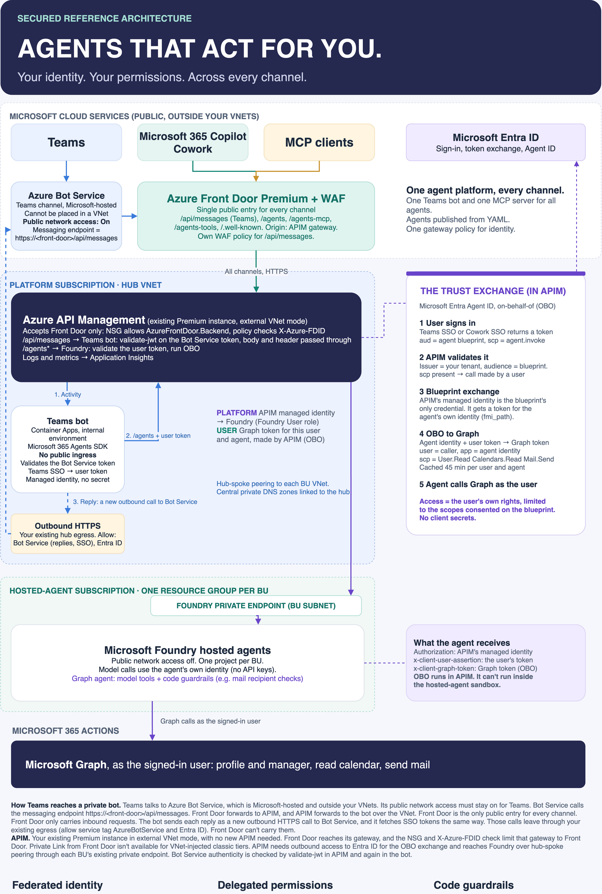

# Agent platform reference: Teams and Copilot Cowork to Foundry hosted agents, as the signed-in user

> **Not production-grade. Use at your own risk.** This repository is a reference
> sample for learning and evaluation, not a production-ready solution. It is
> provided "AS IS", without warranty, under the [MIT License](LICENSE).
> You are responsible for independent security review, testing, hardening, and
> operational readiness before any production use.

Reference implementation for a secured, multi-channel agent platform:

- **One public entry.** Azure Front Door Premium + WAF in front of everything, including Teams (Bot Service messaging endpoint).
- **One gateway.** Azure API Management validates every token, runs the on-behalf-of (OBO) exchange with Microsoft Entra Agent ID, and calls Foundry with its managed identity.
- **Private backends.** Teams bot on an internal Container Apps environment; Foundry hosted agents behind private endpoints.
- **No secrets.** Every credential is a managed identity used as a federated credential.

Editable diagram: [docs/architecture.drawio](docs/architecture.drawio).

## How a request flows

1. The user signs in through the channel's SSO (Teams or Copilot Cowork) and gets a token for the agent blueprint (`scp = agent.invoke`).
2. **Teams:** Bot Service → Front Door → APIM `/api/messages` → bot. The bot calls APIM `/agents/{agent}` inside the VNet with the user's token. **Cowork:** Front Door → APIM MCP server `/agents-mcp/mcp`, tool `ask_agent`.
3. APIM validates the token, then exchanges it (blueprint → agent identity → OBO) for a Microsoft Graph token issued to that agent's own identity for this user.
4. APIM calls the Foundry hosted agent with its managed identity and passes `x-client-user-assertion` and `x-client-graph-token`.
5. The agent calls Graph as the user. Teams replies go from the bot back to Bot Service as a new outbound call; Cowork replies return on the same HTTP response.

Effective access is the user's own rights, limited to the scopes consented on the blueprint.

## Repository layout

| Path | What it is |
|---|---|
| `apiops/` | APIM policies: global Front Door check, `bot-messages`, `agents`, `agents-tools`, `agents-mcp`, protected-resource metadata, and the `agent-obo` fragment |
| `bot/` | Teams bot (Microsoft 365 Agents SDK, Python), Dockerfile, Teams app manifest |
| `agents/graph-profile-agent/` | Sample hosted agent: model tool calling over Graph (profile, manager, calendar, send mail) with guardrails in code |
| `factory/` | Agent definitions (YAML), schema, validation, and the publish script (build → Foundry version → agent identity → smoke test) |
| `m365-cowork-plugin/` | Copilot Cowork plugin (Microsoft 365 Agents Toolkit project) |
| `scripts/` | Admin consent, MCP test client, OBO trace |
| `docs/` | Architecture diagram, [identity and gateway setup](docs/identity-setup.md), [runbook](docs/runbook.md), KQL queries |

## Setup order

1. `cp .env.example .env` and fill in values as you create resources.
2. Identity, bot and APIM: follow [docs/identity-setup.md](docs/identity-setup.md).
3. Build and deploy the bot image to the internal Container Apps environment (`bot/.env.example` lists its settings).
4. Publish the sample agent: `python3 factory/scripts/validate.py && ./factory/scripts/deploy-agent.sh factory/agents/graph-profile-agent.yaml`, then add its agent identity to the APIM named value `agent-child-ids`.
5. Teams: zip `bot/teams-app/` (manifest + icons) and upload it.
6. Copilot Cowork: see [m365-cowork-plugin/README.md](m365-cowork-plugin/README.md).
7. Test: `scripts/test-mcp.sh graph-profile-agent me`; in Teams, say "me" to the bot.

## Prerequisites

- Azure CLI, `jq`, `yq`, Python 3.12, Node.js (for the Microsoft 365 Agents Toolkit CLI).
- APIM classic Premium in external VNet mode (or another tier with public ingress and private backend access).
- A Foundry account and project in a hosted-agent region, with public network access off and a private endpoint.

## Status

The identity chain, APIM policies, Teams bot, Cowork plugin and agent were validated end to end on public endpoints. The private-network design (Front Door in front of Teams, `bot-messages` API, global Front Door check, internal Container Apps, cross-subscription private endpoints) is new in this repo and should be validated in your environment.
